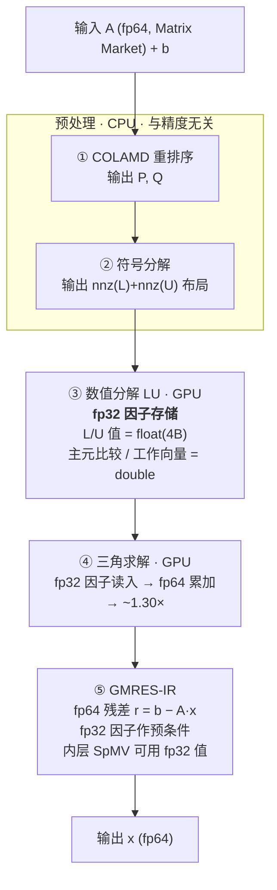

# LUspice

**稀疏 LU 分解的 FP32/FP64 混合精度实现与实测**

面向 SPICE 类电路仿真（MNA 矩阵、每 Newton 迭代重分解）的稀疏 LU 求解器。核心命题：
**把因子存储从 fp64 降到 fp32，用 fp64 主元 + fp64 残差迭代精化（GMRES-IR）把精度补回来**，
在保持 1e-6 相对残差判据的前提下拿到内存/带宽减半的收益。

代码主体是 CUDA 内核，通过 `src/cuda_compat.h` 的 `DSH_*` 抽象层做到「标准 CUDA 子集 + 可迁移」，
不依赖 cuSPARSE / cuSOLVER，可在沐曦 MXMACA / HPCC 栈上重编译。

---

## 1. 核心结论

| # | 结论 | 实测证据 |
|---|---|---|
| 1 | **fp32 因子存储把 LU 因子内存减半**，代价可控 | flash-adc（n=989）因子 **0.104 MB vs 0.221 MB = 2.13×**；bandgap 1.23× |
| 2 | **分解与三角求解各拿 ~1.3× 提速**，但拿不到理论 2× | flash-adc 单线程分解 **1.34×**、三角求解 **1.30×** — 分解受 gather/scatter 与依赖链限制，非纯带宽受限 |
| 3 | **精度不是靠因子精度保的，是靠 fp64 残差保的** | 纯 fp32 直接解在 OTA 上误差 **9.6e2**（完全不可用）；改成 fp32 因子 + fp64 残差 IR 后 bandgap **1.4e-2 → 4.9e-12** |
| 4 | **"fp32 因子 + fp64 主元 + IR" 的适用面比预想宽** | 33 个测试矩阵中 **12 个仅靠该路径达标**，含 κ₂ ≈ 2.8e15 的 rajat22（7.85e-10） |
| 5 | **病态性判据不能用静态 κ 阈值** | rajat22（κ 2.8e15）走 P-fast 成功，OTA（κ 1.5e13）走 P-fast 失败——κ 差两个数量级，结果却相反 |
| 6 | **带宽红利最大的是 SpMV，不是 LU** | 大矩阵（n≥8k）fp32 值存储 **×1.35–2.81**；n≤5k 时被启动延迟吃掉（~1×） |
| 7 | **fp16 是窄众增强，卡在值域而非精度** | 33 矩阵中 32 个有 4–33% 的值小于 fp16 最小正常数 6e-5（1e-12 电容/小导纳）→ 必须先 Ruiz 缩放 |
| 8 | **混合精度的收益是条件性的，条件在目标硬件上不成立** | 同一份代码：3060 上分解 1.34×，沐曦 X201 上 **1.02×**（8 次，CV 2%，区间 [0.97, 1.04]）；同一实验里并行化给了 **29.9×** |

**一句话**：混合精度的收益主要在**带宽**（SpMV、三角求解、因子搬运），不在**算术**；
正确性必须由 **fp64 主元 + fp64 残差** 两道护栏提供，且升级策略要**动态试跑**而非查 κ 表。
而"带宽是不是瓶颈"取决于硬件——在目标平台 X201 上它不是，所以第 8 条成立。

---

## 2. 精度落点：三个优化各在哪一步



逐步骤精度对照（查验源码时按这张表核）：

| 步骤 | fp64 路径 | 混合精度路径 | 护栏 | 实测收益 |
|---|---|---|---|---|
| ① 重排序 | int | 不变 | — | fill-in 340× → 15.8× |
| ② 符号分解 | int | 不变 | — | 静态预分配，零动态分配 |
| ③ 数值分解 | double 8B/值 | **float 4B/值** | 主元比较与工作向量走 double | 内存 2.13× 减半、1.34× |
| ④ 三角求解 | double | **按 float 读因子** | 累加与结果 double | 1.30×（ST） |
| ⑤ 残差 | double | **必须 double** | A、b、r 全 double | 决定 IR 收敛极限 |
| ⑤ 内层 SpMV | double | **float 值存储** | fp64 累加 + IR 修正 | 大矩阵 1.35–2.81× |

---

## 3. 关键实测数字

### 3.1 稀疏 LU：fp32 因子 vs fp64 因子

| 矩阵 | n | fp64 PAR 分解 | fp32/fp64 分解 (ST) | fp32 因子内存 | fp64 因子内存 | 内存比 |
|---|---|---|---|---|---|---|
| bandgap | 113 | 1.14 ms | 1.29× | 0.013 MB | 0.016 MB | 1.23× |
| flash-adc | 989 | 16.9 ms | **1.34×** | 0.104 MB | 0.221 MB | **2.13×** |
| pg2k | 4,050 | 235 ms | 需 Ruiz/shift（否则奇异） | 2.75 MB* | 4.12 MB | 1.50×* |
| pg5k | 5,000 | 311 ms | 同上 | 3.70 MB* | 5.54 MB | 1.50×* |

\* 含索引的 12B→8B/nnz 口径；仅因子值口径为 2×。

三角求解：flash-adc fp32 单线程 **1.30×**；并行化（单 block 256 线程、列串行 + 列内散射并行）
另有 **5.8×**（pg2k 62.4 → 10.7 ms），与精度收益正交、可叠加。

### 3.2 SpMV：精度收益与规模强相关

| 矩阵 | n | fp64 CSR 带宽 | CSR fp32 | SELL fp32 | fp32 误差 |
|---|---|---|---|---|---|
| bandgap | 113 | 1.45 GB/s | 1.00× | 0.98× | 4.8e-7 |
| flash-adc | 989 | 4.8 GB/s | 1.48× | 1.56× | 3.1e-6 |
| pg2k | 4,050 | 68.6 GB/s | 1.01× | 0.93× | 5.6e-8 |
| pg10k | 10,082 | 178.6 GB/s | 0.99× | 0.94× | 2.8e-8 |
| rajat13 | 7,598 | 3.2 GB/s | **1.86×** | **2.73×** | 7.7e-7 |
| rajat10 | 30,202 | 158.0 GB/s | **1.35×** | 1.12× | **0.0** |
| rajat22 | 39,899 | 10.5 GB/s | **2.81×** | 1.25× | 2.8e-6 |

n≤5k 的矩阵内核运行在 µs–10µs 量级，**启动/调度延迟主导**，fp32 的红利被吞掉（~1×）——
这也是"小矩阵必须批处理/常驻"的直接证据。

### 3.3 正确性：33 矩阵判定

| 类别 | 数量 | 路径 | 代表残差 |
|---|---|---|---|
| 良态/中等（GPU 直接达标） | **25** | GPU fp32 因子 + GMRES-IR | bandgap 8.5e-12 / pg2k 7.6e-11 / pg100k 7.1e-10 |
| 病态（CPU 参考达标） | **3** | lu_tool64c（M1 处方：bare/shift/Ruiz） | neural 6.7e-10 / flash 1.7e-10 / sc-dac 3.5e-12 |
| 奇异/排除 | 5 | rajat16/18/20/25 + rajat15 | 基准口径 |

**S₁ 覆盖率 28/33**，判据为 L2 相对误差 ≤ 1e-6；实测多在 1e-10 量级，余量 4 个数量级。

### 3.4 加速比现状（诚实口径）

| 版本 | pg2k | pg5k | pg10k |
|---|---|---|---|
| 单 thread 内核 | SR 0.003 | SR 0.003 | — |
| wave/level 并行 | **SR 0.154** | **SR 0.168** | **SR 0.218** |

SR = T_cpu / T_gpu（CPU 基线为 KLU 单线程）。**当前 GPU 版本仍慢于 CPU**，
瓶颈在分解阶段的并行度（Occupancy 1.04% → 目标 ≥60%），不在精度。
混合精度的贡献与并行化正交：因子减半 + 三角求解 1.3× 可在并行化收益之上叠加。

### 3.5 目标平台 X201：收益归零，并行化接管

同一份代码（md5 已核对，逐字节一致）在沐曦 X201 上跑 pg2k（n=4050），8 次有效运行：

| 指标 | 中位 | CV | 范围 |
|---|---|---|---|
| 分解加速（fp32 因子，ST） | **1.017** | 2.05% | [0.972, 1.042] |
| 三角求解加速（ST） | 1.012 | 1.29% | [0.994, 1.030] |
| 因子内存（含索引） | 4.776 → 3.184 MB = **1.50×** | — | — |
| nnz(L+U) 一致性 | 397976 = 397976 | — | 无损 |

同一次实验里，**并行化给的是 29.9×**（分解 21.9 s → 733 ms），三角求解并行 8.8×。

按实验脚本自定的判读口径（CV 0.5%–3% → 只报区间），正确表述是
**"分解加速落在 [0.97, 1.04]，与 1.0 无法区分"**，而不是"1.02×"。

原因：X201 的 HBM 带宽约 1843 GB/s（3060 的 5 倍），且该内核在 X201 上是
**延迟受限**而非带宽受限（21.9 s 的绝对耗时说明远未跑满吞吐）。
字节减半对"等待次数"无效，所以时间不变。详见
[docs/07_platform_notes.md](docs/07_platform_notes.md)。

---

## 4. 快速开始

### 4.1 编译（单卡开发环境）

```bash
# 依赖：CUDA ≥ 11.0（sm_70+）、COLAMD（SuiteSparse 或 ngspice 内置副本）
nvcc -O3 -arch=sm_86 -std=c++14 -I src -I src/third_party -I <colamd 头父目录> \
     -o mp_lu_bench src/mp/mp_lu_bench.cu src/cpu_ref_lu.c \
     <path>/colamd.c <path>/colamd_global.c
```

沐曦 MXMACA / HPCC 栈：

```bash
HPCC_PATH=/opt/hpcc
$HPCC_PATH/htgpu_llvm/bin/htcc -x hpcc -offload-arch native -std=c++17 \
    -I$HPCC_PATH/include -I src -o mp_lu_bench src/mp/mp_lu_bench.cu src/cpu_ref_lu.c
```

`cuda_compat.h` 负责把 `cudaMalloc / cudaMemcpy / __global__` 等映射到目标后端，
业务代码不需要改动。

### 4.2 运行基准

```bash
# 单矩阵：<s0.mtx> <s0.rhs> [pin] [flt] [max_n_st] [reps]
./mp_lu_bench /tmp/s0/pg2k.mtx /tmp/s0/pg2k.rhs 1e-8 1 15000 3

# 全批（Matrix Market → s0 转换 + 全部基准 + JSON 聚合）
bash scripts/run_gpu_bench.sh
```

产物写到 `results/mp_gpu_bench.json`，每矩阵一行，含 fp64/fp32 各阶段耗时、
因子内存、SpMV 带宽与相对误差。

### 4.3 复现验证（2026-10-29 实跑）

仓库整理完成后按 `docs/06_reproduce.md` 从零编译并实跑，与报告数字对照：

| 矩阵 | 指标 | 报告值 | 本次实测 | 一致性 |
|---|---|---|---|---|
| bandgap (n=113) | 因子内存 fp64 / fp32 | 0.016 / 0.013 MB | 0.016 / 0.013 MB | ✅ |
| bandgap | 分解加速比（ST） | 1.29× | **1.289×** | ✅ |
| flash-adc (n=989) | 因子内存 fp64 / fp32 | 0.221 / 0.104 MB（2.13×） | 0.221 / 0.104 MB | ✅ |
| flash-adc | 分解加速比（ST） | 1.34× | **1.331×** | ✅ |
| flash-adc | 三角求解加速比（ST） | 1.30× | **1.298×** | ✅ |

同一轮实跑还暴露了一件事，值得单列：**flash-adc 上 fp32 因子直接解的相对误差是 2.4e9**，
且 fp32 分解得到的非零元从 18427 掉到 13038（丢失 29%）——fp32 路径在这个矩阵上已经
**结构性退化**，不是"精度差一点"。这正是 `04_adaptive_policy.md` 把它划进 P-safe
（fp64 + shift）的原因：这类矩阵不存在"用 fp32 因子省点内存"的选项。

对比 bandgap：同样的 fp32 因子 + fp32 三角求解，误差 8.4e-4（差但可用），
说明**同一条路径在不同矩阵上的可靠性差异跨越 12 个数量级**，无法用统一开关控制。

---

## 5. 仓库结构

```
LUspice/
├── src/                    # 求解器核心
│   ├── cuda_compat.h       # DSH_* 后端抽象层（CUDA / MXMACA）
│   ├── lu_gpu.cu           # fp64 基线：单线程左视 LU + 三角求解
│   ├── lu_gpu_f32.cu       # ★ 混合精度：fp32 因子 + fp64 主元/累加
│   ├── lu_gpu_par.cu       # 单 block 并行分解
│   ├── lu_gpu_wave.cu      # wave/level 并行调度
│   ├── lu_static.c/.h      # 静态化：符号分解复用 + 零动态分配
│   ├── symbolic_u.c        # 符号分解
│   ├── spmv.cu / sellc_spmv.cu   # CSR / SELL-C-σ SpMV
│   ├── ir_spmv_bench.cu    # IR 内层 SpMV 混合精度基准
│   ├── cpu_ref_lu.c        # CPU 参考实现（正确性对照）
│   └── mp/                 # 混合精度专项基准（LU/SpMV/fp16/批处理/融合/smem）
├── bench/                  # 测试与验收程序
├── docs/                   # 设计文档（01–07）+ 原始设计稿 appendix
├── results/                # 实测 JSON + 报告 + 实验记录
│   └── x201_20261029/      # ★ 目标平台（沐曦 X201）实测：原始 jsonl + 分析
└── scripts/                # 复现脚本
```

---

## 6. 平台与局限

**两个平台，两套结论。**

| | RTX 3060（开发代理） | Mars X201（目标硬件） |
|---|---|---|
| 栈 | CUDA 12.6 + nvcc | HPCC 3.5.3 + `cucc` |
| HBM 峰值 | ~360 GB/s | **~1843 GB/s** |
| 覆盖范围 | 全部内核 + 33 矩阵正确性 | **仅 pg2k**（分解 + 三角求解） |
| 混合精度收益 | 分解 1.34× / 三角 1.30× / SpMV 最高 2.81× | 分解 **1.02×** / 三角 **1.01×** |

3060 之所以当代理：目标平台的工具链可用性受限，先在架构可控的平台上把内核和精度
结论跑通，`cuda_compat.h` 保证源码级可迁移。**验证结果：服务器上跑的二进制与仓库源码
逐字节一致（md5 已核），代码迁移本身没问题。**

**但结论没有跟着迁移。** X201 上 fp32 因子对分解时间的影响落在 `[0.97, 1.04]`
（8 次运行，CV 2.05%），即**无可测收益**；同一次实验里并行化给的是 **29.9×**。
原因与边界见 [docs/07_platform_notes.md](docs/07_platform_notes.md)。

一句话规则：**与容量有关的结论（内存减半、布局复用）可以跨平台；与时间/带宽有关的
必须在目标平台上重测。**

**已知未完成**：

- 分解阶段并行度不足（单 block 内核 Occupancy 1.04%），SR 仍 < 1；
- 病态矩阵上 GPU 三角求解数值 1.9e-4 vs CPU 5e-16（FMA / 累加顺序差异）；
- fp16 路径仅完成可行性判定，未实现 Ruiz 缩放后的完整流程；
- **X201 侧只测了 pg2k 一个矩阵的两段**，SpMV 与 GMRES-IR 端到端未测；
- X201 上该内核存在偶发 `illegal memory access`（9 次尝试 1 次，位置未定位）。

**已核实不可用**（避免重复踩坑）：`hcsolverSp` 的稀疏直接求解入口在目标栈上全部返回
`NOT_SUPPORTED`，`cub::DeviceReduce` 在 cc10.0 上越界访存 —— 稀疏 LU 必须自研。

---

## 7. 文档索引

| 文档 | 内容 |
|---|---|
| [docs/01_architecture.md](docs/01_architecture.md) | 混合精度架构对照：三个优化的代码位置与查验点 |
| [docs/02_precision_budget.md](docs/02_precision_budget.md) | 精度预算与正确性边界（哪一步能降、哪一步不能） |
| [docs/03_gmres_ir.md](docs/03_gmres_ir.md) | GMRES-IR 设计与验收（外层/内层/容差取值的实测依据） |
| [docs/04_adaptive_policy.md](docs/04_adaptive_policy.md) | 自适应精度升级链（P-fast / P-safe / P-hard / P-singular） |
| [docs/05_static_storage.md](docs/05_static_storage.md) | 静态化存储与符号复用（零动态分配） |
| [docs/06_reproduce.md](docs/06_reproduce.md) | 复现手册：环境、编译、逐项对表 |
| [docs/07_platform_notes.md](docs/07_platform_notes.md) | 平台差异与结论迁移：哪些数字能搬、哪些不能 |
| [results/README.md](results/README.md) | 数据字典：每个 JSON 的口径与字段含义 |
| [results/x201_20261029/ANALYSIS.md](results/x201_20261029/ANALYSIS.md) | 沐曦 X201 实测：8 次运行、统计量、与 3060 的对照 |

---

## 8. 许可

MIT，见 [LICENSE](LICENSE)。

代码源自「基于国产 GPU 的稀疏矩阵求解及 SPICE 加速」课题工作，
CPU 参考路径与 COLAMD 依赖来自 ngspice / SuiteSparse（各自原许可）。
