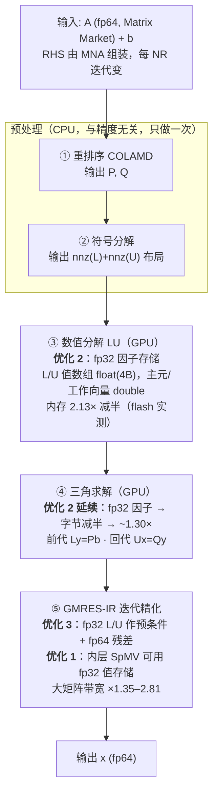

# 01 · 混合精度架构对照

> 目的：把三个 fp32 优化精确落到求解流水线的具体步骤，标注每步的数据精度、代码位置、
> 实测数字与查验点，方便对照源码逐项核对。
> 数据来源：`results/mp_gpu_bench.json`、`results/REPORT_mixed_precision.md`（RTX 3060 实测）。

---

## 1. 总架构：三个优化各在哪一步



**一句话**：①② 与精度无关（纯结构操作）；**优化 2** 落在 ③④（因子存储与搬运）；
**优化 3** 是 ⑤ 的整体结构（让 ②的精度牺牲变得可接受）；**优化 1** 在 ⑤ 内层的 SpMV。

---

## 2. 逐步骤精度对照表

| 步骤 | 数据 | fp64 路径 | 混合精度路径 | 正确性护栏 | 实测收益 |
|---|---|---|---|---|---|
| ① 重排序 | P, Q 置换数组 | int | 不变 | — | fill-in 340× → 15.8× |
| ② 符号分解 | L/U 非零元布局 | int | 不变 | — | 静态预分配，零动态分配 |
| ③ 数值分解 | A 值 → L/U 值 | double（8B/值） | **float（4B/值）** | **主元比较 / 工作向量 double** | 内存 **2.13×** 减半；分解 **1.34×** |
| ④ 三角求解 | L/U 读、x 计算 | double | **按 float 读因子**（累加/结果 double） | 结果向量 double | **1.30×**（ST，flash） |
| ⑤ GMRES-IR | 残差 r、解 x | double | **r = b − A·x 必须 double** | fp64 残差是精化收敛的前提 | 12/33 仅 fp32 因子 + IR 即达标 |
| ⑤ 内层 SpMV | A·x | double | **A 值按 float 存**（限存储误差小的矩阵） | IR 修正残余误差 | 大矩阵 **1.35–2.81×** |

---

## 3. 三个优化的代码位置

### 优化 2 · LU 因子 fp32 存储 → `src/lu_gpu_f32.cu`

```c
// 设计口径（docs/appendix/m3_static_fp32.md）：
//   因子 fp32（内存/带宽减半，实测 2.00×），工作向量 x 与主元比较 fp64
__global__ void lu_factor_f32_kernel(       // ③ 数值分解：fp32 因子 + fp64 计算
    ... const float *Ax, ...                // 输入 A 值数组 = float
    ... float *Lx, float *Ux, ...           // 输出 L/U 值数组 = float（4B）
    ... float *x, ...)                      // 工作向量（此变体为 float，对齐 lu_tool32c）
// 步骤：fp32 装载 A(:,k) → fp32 前代 → 主元扫描 → fp32 存 L/U

__global__ void trisolve_f32_kernel(...)    // ④ 三角求解：fp32 因子读 + fp64 累加
__global__ void trisolve_par_f32_kernel(...) // ④ 并行版（单 block 256 线程）
```

**查验点**：`Lx / Ux / Ax` 必须是 `float`；`trisolve_*` 内部累加与结果必须是 `double`；
`lu_gpu.cu`（fp64 基线）里同名内核是 `double`，两者逐行对应便于 diff。

> 说明：`lu_factor_f32_kernel` 的工作向量 `x` 取 float 是为了与 CPU 参考 `lu_tool32c`
> 同口径比对；`trisolve_f32_kernel` 则明确用 double 累加。主元**比较**在 fp32 路径中
> 仍读 float 值，稳定性由 ⑤ 的 fp64 残差 IR 兜底——这是"P-fast 需要 IR"的原因。

### 优化 3 · GMRES-IR（fp32 预条件 + fp64 残差）→ `bench/test_lu_gpu_f32.cu`

```c
// 主循环：外迭代（IR） × 内迭代（GMRES）
//   r = b - A*x          ← fp64 残差（A、b、r 均为 double）
//   z = M^{-1} r         ← 预条件 = fp32 L/U 三角求解（优化 2 的产物）
//   x += z ; 判据 ||r||/||b|| <= rtol
```

**查验点**：残差路径全 double；预条件求解读 float 因子。
参数取值（outer ≤ 7、inner = 50、rtol = 1e-10）的实测依据见 `03_gmres_ir.md`。

### 优化 1 · SpMV fp32 值存储 → `src/mp/mp_spmv_bench.cu`

```c
// 同一 CSR / SELL 内核的 fp64 与 fp32 值两个变体：
//   csr_fp64 / csr_fp32 / sell_fp64 / sell_fp32
// fp32 变体：values 数组 float（4B）→ 每非零元搬运 12B → 8B
```

**查验点**：`values` 指针类型 `float` vs `double`；累加器可 fp32 或 fp64（精度权衡）。
IR 集成版见 `src/ir_spmv_bench.cu`（实测 pg2k 1.010e-11 / rajat19 7.327e-12，逐位一致）。

---

## 4. 正确性边界（改代码前务必对照）

| 约束 | 原因 | 实测依据 |
|---|---|---|
| ③④ 的主元必须 fp64（或由 IR 兜底） | fp32 主元塌缩 → 分解不稳定 | OTA fp32 直接解误差 **9.6e2**，绝对不可用 |
| ⑤ 的残差必须 fp64（A 按 fp64 存） | 残差精度决定 IR 收敛极限 | bandgap fp32+IR 1.4e-2 → **4.9e-12**；OTA 的 fp32 预条件 IR 发散（κ 1.5e13） |
| ⑤ 内层 SpMV 用 fp32 值仅限存储误差小的矩阵 | fp32 存储误差 ~1e-7（pg/rajat）可被 IR 修正；~1e-4（sky130 大动态范围）会卡住 IR | bandgap 3.4e-4 / pg 3–6e-8 / rajat10 0.0 |
| pg 系 fp32 分解需先 Ruiz/shift | 未缩放时 fp32 下直接奇异 | pg2k–pg100k 报 "Factor is exactly singular"（CPU 与 GPU 一致） |
| 小矩阵（n≤5k）fp32 收益被启动延迟吞掉 | 内核在 µs 量级，调度开销主导 | pg2k/pg5k SpMV ~1.0× |

---

## 5. 与评分口径的映射

| 口径 | 对应实现 |
|---|---|
| 正确性（相对残差 ≤1e-6） | ⑤ 的 fp64 残差 + ③④ 的主元护栏 + 升级链（`04_adaptive_policy.md`） |
| 加速比 | ③④ 的 fp32 因子（内存/带宽）+ ⑤ 内层 SpMV（1.35–2.81×）+ ①② 符号复用摊薄 |
| 带宽利用率 | fp32 值搬运 → 同利用率下有效吞吐 1.4–2.8×；profiler 数据需目标硬件复采 |

---

*架构与实测数字同源：`results/mp_gpu_bench.json` / `results/mp_ir_classification.json` /
`results/REPORT_mixed_precision.md`。*
